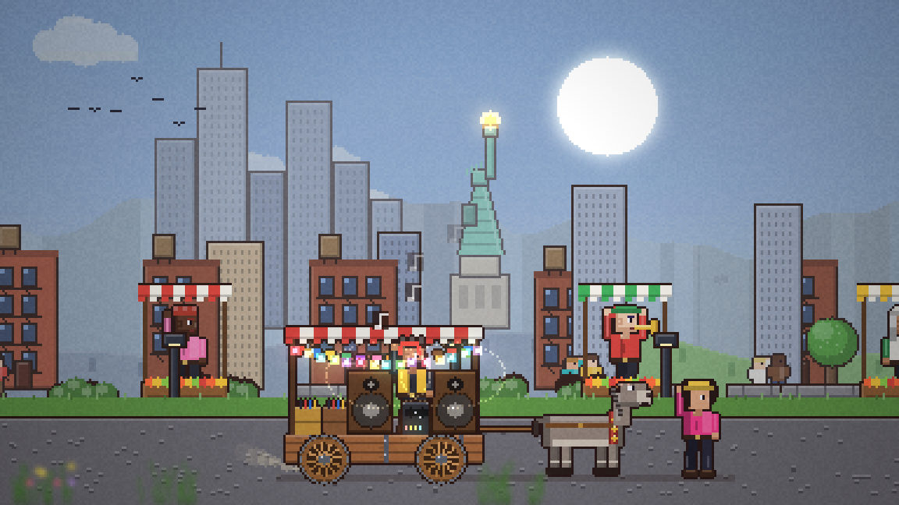
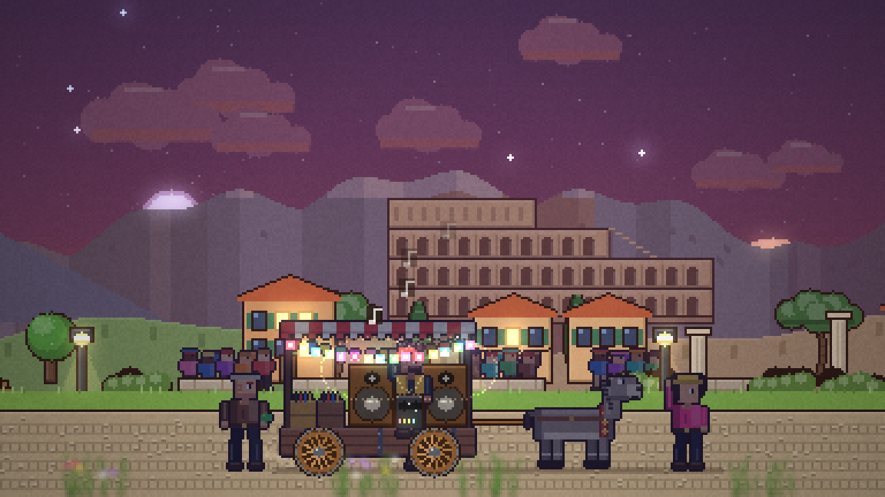
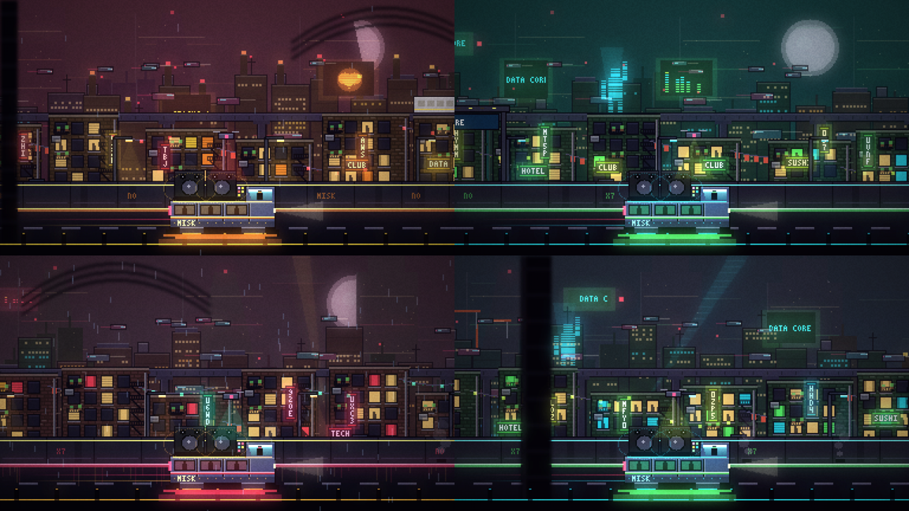
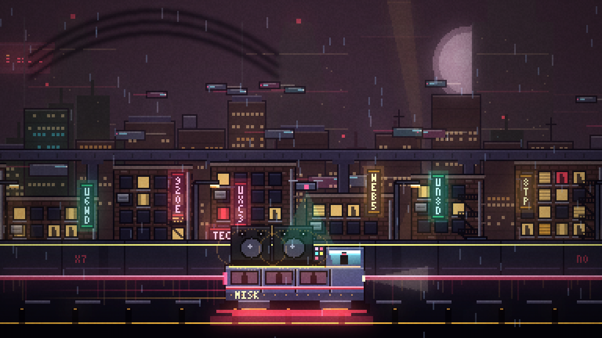
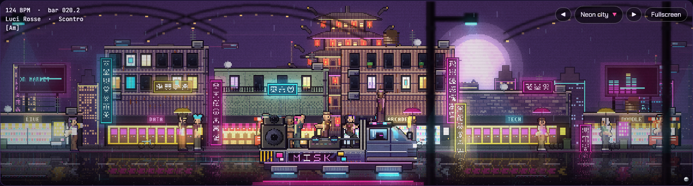
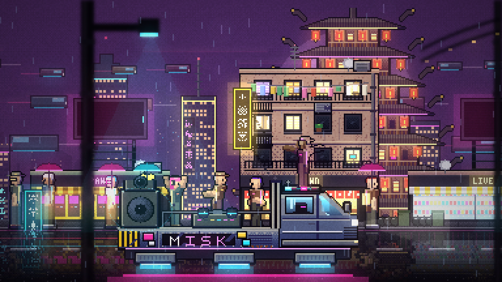
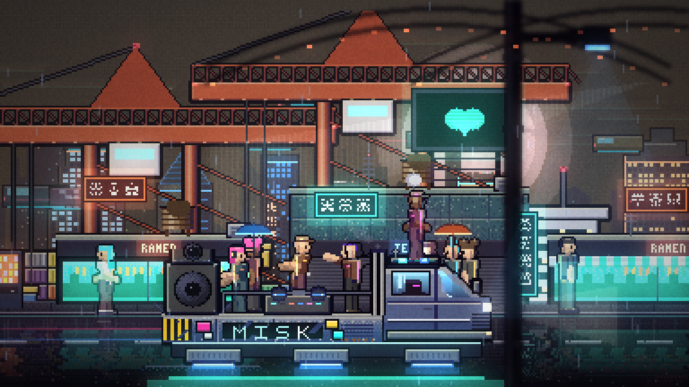
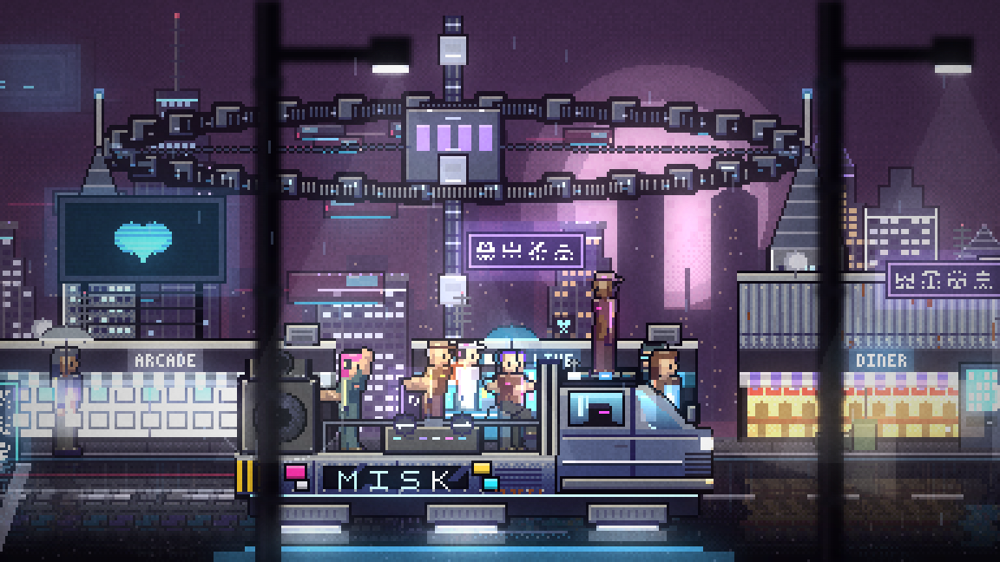
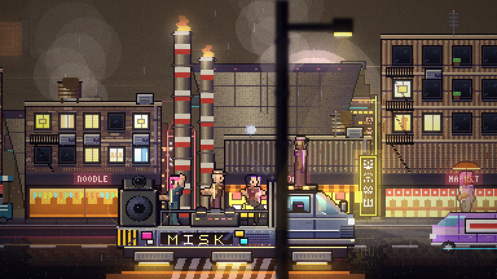
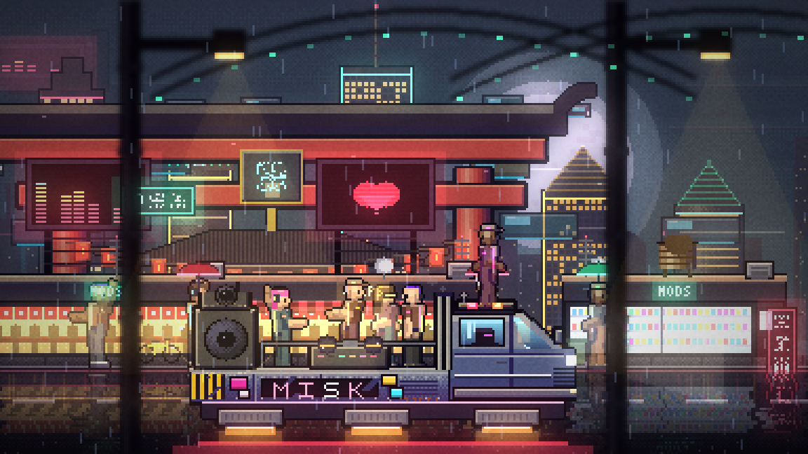

# Endless visuals: iterations

Every iteration of the endless scrolling visuals stays in the code and can be picked from the visual menu, so versions can be compared side by side. Each one also has a git tag and screenshots here.

| Version | Tag | Code | Looks | Notes |
| --- | --- | --- | --- | --- |
| v1 (2026-10-17) | `visuals-v1` | `src/visuals/v1/` | Caravan v1, Neon city v1 | First engine: parallax layers, seeded zones, day and night. Sprites drawn by rule. |
| v2 (2026-10-17) | `visuals-v2` | `src/visuals/v2/` | Caravan v2, Neon city v2 | Light buffer with bloom hidden by what is in front, haze per layer, blurred front layers, vignette and grain; 216 px high; detailed outlined characters, cart with a DJ, more layers (mountains, hills, town with crowd, bushes, stalls), neon city with nine layers, facades, train, hologram, parapet, steam. |
| v3 (2026-10-17) | `visuals-v3` | `src/visuals/neon-city.js`, `src/visuals/neon/`, `src/visuals/pixel-art.js` (current) | Neon city (Caravan still v2) | Close camera: the street fills the picture, people are a sixth of its height. Every object is a detailed sprite baked once from its seed (facades, shops, signs, towers, people, the truck, traffic). People built from a skeleton with dance poses. One huge landmark per district that lingers in the middle while its district goes by. Traffic in the far lane, a wet road that mirrors the street, a blimp, billboards, food carts, front lamps out of focus. |

## v1

## v2

## v3

