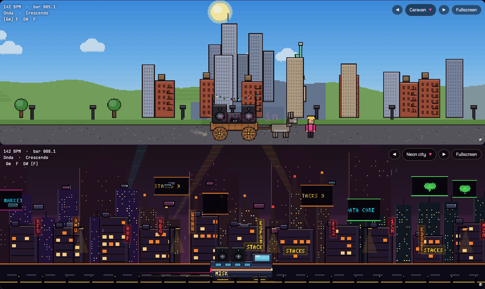
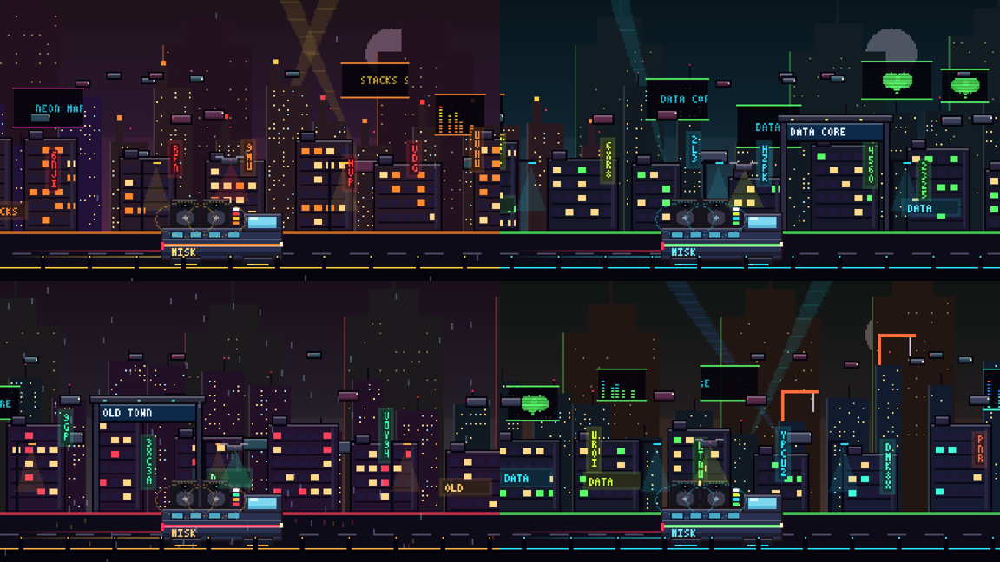
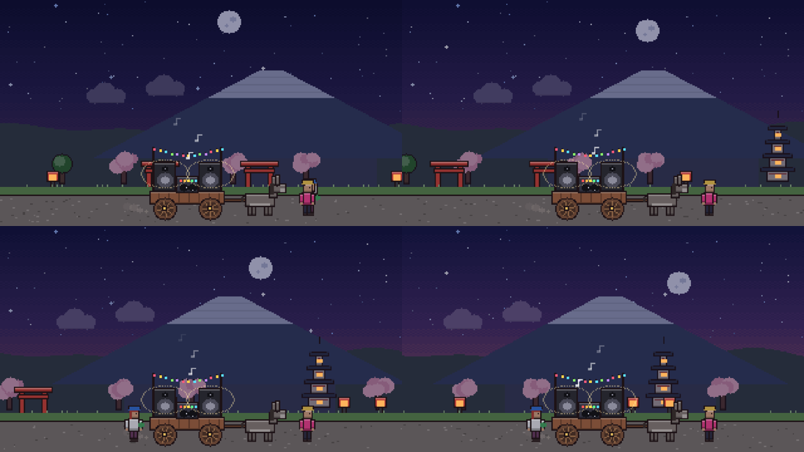

# Endless visuals: iterations

Every iteration of the endless scrolling visuals stays in the code and can be picked from the visual menu, so versions can be compared side by side. Each one also has a git tag and screenshots here.

| Version | Tag | Code | Looks | Notes |
| --- | --- | --- | --- | --- |
| v1 (2026-10-17) | `visuals-v1` | `src/visuals/v1/` | Caravan v1, Neon city v1 | First engine: parallax layers, seeded zones, day and night. Sprites drawn by rule. |

## v1

